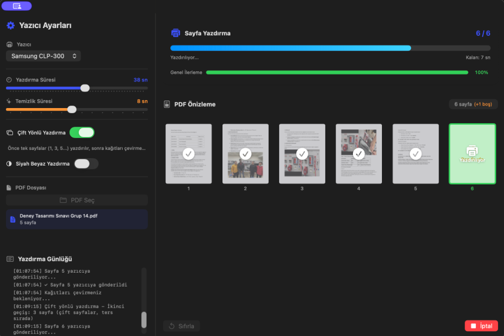
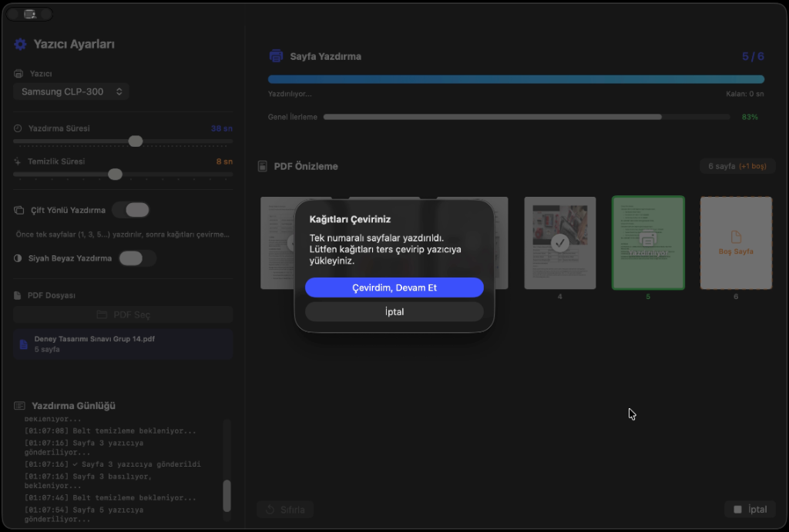
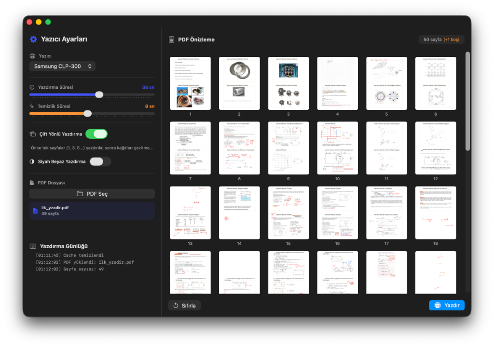

# PrinterManager for macOS 🖨️

<div align="center">

[](README.md)
[](README_EN.md)

</div>

Lazer yazıcılardaki belt (transfer kayışı) yıpranma sorununu çözen native macOS uygulaması. Çok sayfalı PDF'leri yazdırırken sayfalar arası bekleme süresi ayarlayarak, yazıcının transfer kayışının aşırı ısınmasını önler.

> 🧪 **Test:** Samsung CLP-300 ile test edilmiştir, benzer sorun yaşayan tüm lazer yazıcılarda kullanılabilir.



## 📥 İndirme

**[⬇️ PrinterManager v1.0.0 DMG İndir](https://github.com/emregms/printer-manager/releases/download/v1.0.0/PrinterManager-v1.0.0.dmg)**

### ⚠️ İlk Açılışta macOS Uyarısı

macOS imzasız uygulamaları engeller. Uygulamayı açmak için:

**Yöntem 1 - Terminal (Önerilen):**

```bash
xattr -cr /Applications/PrinterManager.app
```

**Yöntem 2 - Manuel:**

1. Uygulamaya **sağ tıklayın** (veya Control+tıklama)
2. **"Aç"** seçeneğini tıklayın
3. Açılan pencerede tekrar **"Aç"** butonuna tıklayın

## Özellikler

- **Kendi Sürücü (Samsung CLP-300)**: macOS'taki eski Samsung sürücüsü yerine sayfaları uygulama kendisi hazırlar (Ghostscript + foo2qpdl) ve yazıcıya ham olarak gönderir. Yoğun, renkli ve vektör ağırlıklı sayfalar da sorunsuz basılır
- **Ayarlanabilir Bekleme Süreleri**: Yazdırma ve temizlik süreleri slider ile ayarlanır
- **Sayfa Sayfa Yazdırma**: Her sayfa ayrı ayrı yazıcıya gönderilir
- **Çift Yönlü Yazdırma**: Tek → Çevir → Çift sayfalar ters sırada
- **PDF Önizleme**: Thumbnail grid ile tüm sayfaları görüntüle
- **Durdur/Devam**: Yazdırmayı duraklatıp devam ettirin
- **Tahmini Süre**: Kalan yazdırma süresini görün
- **Siyah Beyaz Modu**: Daha hızlı ve ekonomik yazdırma
- **Native macOS**: Swift + SwiftUI, Apple Silicon optimize

## Ekran Görüntüleri

<p align="center">
  
  <br/>
  <em>Sayfa sayfa yazdırma ve ilerleme durumu</em>
</p>

<p align="center">
  
  <br/>
  <em>Çift yönlü yazdırma - kağıt çevirme uyarısı</em>
</p>

## Gereksinimler

- macOS 13.0 (Ventura) veya üzeri
- Intel veya Apple Silicon (M1/M2/M3)
- Kendi sürücü için: [Ghostscript](https://www.ghostscript.com) (Homebrew ile)

## Yeni Bir Mac'e Kurulum (sıfırdan)

Samsung'un eski sürücüsü **gerekmez**. Bir kez yapılır:

1. **Ghostscript:** Homebrew yoksa [brew.sh](https://brew.sh) adresindeki komutla kurun, sonra:

   ```bash
   brew install ghostscript
   ```

   Homebrew kuruluysa bunu uygulamanın Ayarlar penceresindeki **Ghostscript'i Kur** düğmesi de yapar.
2. **Uygulama:** PrinterManager'ı `/Applications` klasörüne koyun ve açın (ilk açılış için yukarıdaki macOS uyarısı adımları).
3. **Yazıcı:** CLP-300'ü USB ile bağlayıp açın. PrinterManager'da **Ayarlar (⌘,) → macOS Sürücüsü → Sürücüyü Kur ve Yazıcıyı Ekle** deyin ve yönetici şifrenizi macOS'un penceresine girin. Yazıcı, Yazıcılar ve Tarayıcılar'a "Samsung CLP-300" olarak eklenir.
4. **İsteğe bağlı**, aynı pencerenin "Başka Uygulamalardan Yazdırma" bölümünden:
   - Yazdırma penceresinin PDF menüsüne "PrinterManager ile Yazdır"ı ekleyin.
   - "Oturum açılınca başlat"ı açın; başka uygulamalardan gönderilen belgeler hemen gelir.

Sol paneldeki **Sürücü** bölümünde "Ghostscript" ve "foo2qpdl" yeşil tikli görünmelidir. foo2qpdl ayrıca kurulmaz; uygulamanın içinde gelir.

Yazıcı bu Mac'te Samsung'un eski sürücüsüyle zaten ekliyse ona dokunulmaz; yanına "Samsung CLP-300 (PrinterManager)" adlı ikinci bir yazıcı eklenir. Uygulama sayfaları iki yazıcıya da `lp -o raw` ile, filtresiz gönderir.

## Başka Uygulamalardan Yazdırma

Transfer kayışı temizleyicisi bozuk olduğu için bu yazıcı her baskıda sayfa arası bekleme ister. Bu yüzden Safari, Önizleme gibi uygulamalardan doğrudan basılmaz; belge PrinterManager'da açılır, oradan beklemeli (ve istenirse elle çift yönlü) basılır:

- **Yazıcıyı seçerek:** Yazdırma penceresinde "Samsung CLP-300" (PrinterManager sürücüsüyle eklenen) yazıcısını seçip **Yazdır** deyin. Yazdırma Sırası'nda kısa bir süre "PrinterManager'da açılıyor…" görünür; PrinterManager birkaç saniye içinde belgeyi alır, işi siler ve pencerede açar. Yazıcıya hiç veri gitmez. Uygulama kapalıysa iş 30 saniye sonra "PrinterManager açık değil" mesajıyla durur; PrinterManager'ı açınca belge gelir.
- **PDF menüsünden:** Herhangi bir yazdırma penceresinde sol alttaki **PDF ▾ → PrinterManager ile Yazdır**. Hangi yazıcı seçili olursa olsun belge PrinterManager'da açılır.
- **Finder'dan:** PDF'e sağ tıklayın → **Birlikte Aç → PrinterManager**.
### Neden?

Samsung'un CLP-300 için son Mac sürücüsü 2008'den kalma ve Apple Silicon'da Rosetta ile çalışıyor. Bu sürücünün `rastertosec` filtresi yoğun ya da renkli sayfalarda çöküyor (`JBIGClipColorFullPage`, SIGSEGV). Kuyrukta "Filter failed" hatası görünüyor. Yazıcı ise yarım kalmış veriyi aldığında `SPL-C ERROR - Including Corrupted Data` sayfası basıyor.

Kendi sürücü bu filtreyi tamamen devre dışı bırakır:

```
PDF sayfası → Ghostscript (bitcmyk / pbmraw) → foo2qpdl -z0 -p2 → lp -o raw → yazıcı
```

Parametreler, Linux'ta yıllardır CLP-300 için kullanılan foo2zjs projesinin `foo2qpdl-wrapper` betiğinden birebir alınmıştır (A4, 1200x600 dpi). Her sayfa PDF'in kendisinden render edilir; yatay ve Letter sayfalar A4'e sığdırılır.

## Kullanım

1. **Yazıcı Seçin** → Dropdown'dan yazıcınızı seçin
2. **Süreleri Ayarlayın** → Yazdırma (30sn) + Temizlik (8sn)
3. **Sürücü ve Kalite** → "Kendi sürücü (önerilen)", kalite 1200x600 dpi (600 dpi daha hızlı ve daha az veri, 1200x1200 en iyi)
4. **PDF Seçin** → Dosyanızı yükleyin
5. **Yazdır** → İlerlemeyi izleyin

Gelişmiş ayarlar (⌘, ya da Sürücü başlığının yanındaki düğme): Ghostscript ve foo2qpdl yolları, ham gönderim kuyruğu. Boş bırakılırsa otomatik bulunur.

## Sorun Giderme

| Durum | Ne yapmalı |
|---|---|
| "Ghostscript bulunamadı" | `brew install ghostscript`. Başka bir yerdeyse yolunu Ayarlar'a (⌘,) girin. |
| "Yazıcı kuyruğu durdurulmuş" | Sistem Ayarları > Yazıcılar ve Tarayıcılar > Yazdırma Sırası > Sürdür, ya da `cupsenable Samsung_CLP_300 && cupsaccept Samsung_CLP_300` |
| "Kuyrukta bekleyen iş var" | Önceki takılı işleri Yazdırma Sırası penceresinden silin (`cancel -a Samsung_CLP_300`). |
| "Yazıcı kapalı görünüyor" | Yazıcıyı açın, USB kablosunu kontrol edin. Yazdırma sırasında yazıcı hazır olana kadar uygulama bekler. |
| "Sayfa N çok büyük" | Sayfa verisi 8 MB'ı aşmış (olağan: 1–4 MB). "600 dpi ile Gönder" veriyi yaklaşık yarıya indirir. |
| Yazıcı `SPL-C ERROR` sayfası basıyor | Sürücü modunun "Kendi sürücü" olduğundan emin olun; "Sistem sürücüsü" bu hatayı verir. Devam ederse kaliteyi 600 dpi yapın. |
| Safari'den yazdırınca belge PrinterManager'da açılmıyor | PrinterManager açık mı? Yazdırma penceresinde PrinterManager sürücüsüyle eklenen yazıcı mı seçili? Ayarlar → macOS Sürücüsü'nde "Kurulu" yazmalı; eski sürümle kurduysanız **Sürücüyü Güncelle** deyin. |
| Yazdırma Sırası'nda "PrinterManager açık değil" | PrinterManager'ı açın; durdurulan iş birkaç saniye içinde alınır ve belge açılır. |
| Ayrıntı gerekiyor | Yazdırma Günlüğü her sayfanın boyutunu, süresini ve Ghostscript uyarılarını gösterir. |

"Sistem sürücüsü" modu eski yol olarak ayarlarda duruyor (PDFKit ile bölüp `lp` ile gönderir); yalnızca yedek olarak kullanın.

## Kaynak Koddan Derleme

```bash
git clone https://github.com/emregms/printer-manager.git
cd printer-manager
open PrinterManager.xcodeproj
# Xcode'da ⌘+R ile çalıştırın
```

Derleme sırasında iki yardımcı program otomatik derlenip uygulama paketine (`Contents/Helpers/`) konur:

- `foo2qpdl`: `ThirdParty/foo2qpdl` klasöründeki kaynaktan.
- `cups-jobs`: `Driver/cups-jobs.c`'den. Bekletilen işleri listeler, belgelerini alır ve işi siler.

Yazıcı kuyruğunun dosyaları (`pminbox` filtresi, PPD, `install-driver.sh`) `Driver/` klasöründedir.

## Lisans

[MIT](LICENSE) - Hüseyin Emre Gümüş (info@hegg.tr)

Uygulama içinde gelen **foo2qpdl** bu lisansa dahil değildir: foo2zjs projesinden (Rick Richardson; JBIG kodu Markus Kuhn) alınmıştır ve **GPL-2.0** lisanslıdır. Kaynak, Debian'ın `foo2zjs_20200505dfsg0` paketidir (asıl site artık yayında değil). Uygulama onu ayrı bir program olarak çalıştırır; kodu Swift'e kopyalanmamıştır. Değiştirilmemiş kaynak kodu, lisans metni (`COPYING`) ve kaynağın nereden alındığı [ThirdParty/foo2qpdl](ThirdParty/foo2qpdl) klasöründedir. Lisans metni uygulama paketinde `Contents/Resources/foo2qpdl-COPYING.txt` olarak da bulunur.
