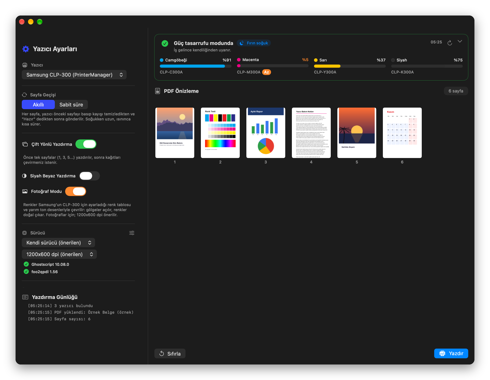
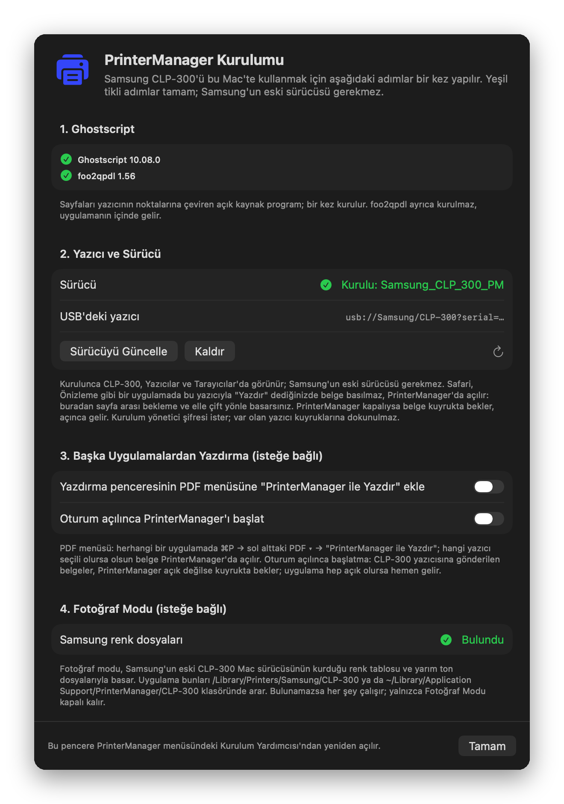
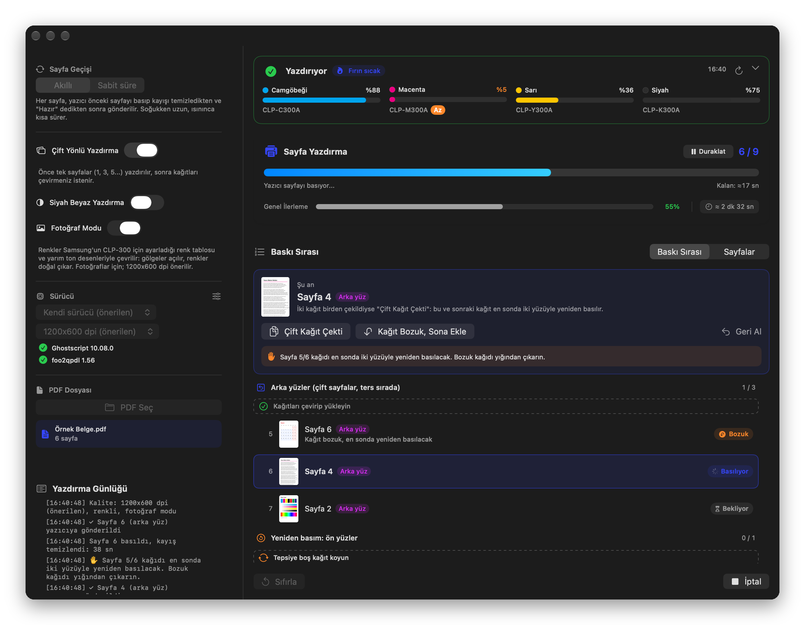
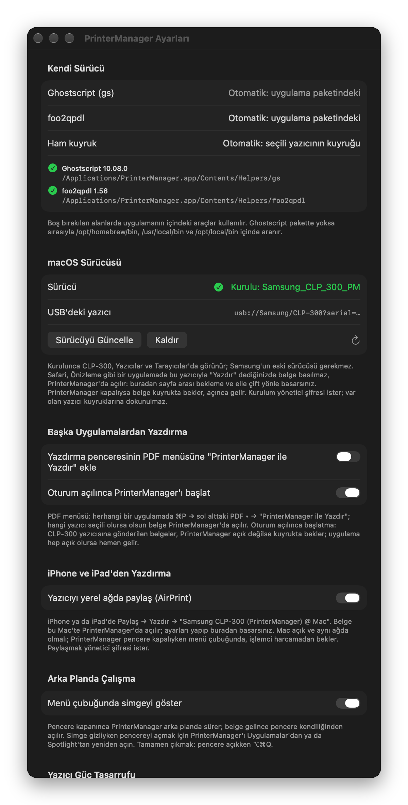

# PrinterManager for macOS 🖨️

<div align="center">

[](README.md)
[](README_EN.md)
[](#requirements)
[](#requirements)

</div>

**A macOS driver and printing app for the Samsung CLP-300.** It replaces Samsung's 2008 Mac driver, which crashes on Apple Silicon: the app prepares each page itself and sends it straight to the printer. On printers with a worn transfer belt cleaner, each page is sent only after the printer has printed the previous one and cleaned the belt. Double feeds, photo printing, toner, error codes and the printer staying hot while idle are all handled in one window.

The app's interface is in Turkish; the English names are given in parentheses below.



## 📥 Download

**[⬇️ PrinterManager v2.0.0 (DMG, 3.6 MB)](https://github.com/emregms/printer-manager/releases/download/v2.0.0/PrinterManager-v2.0.0.dmg)** · [All releases](https://github.com/emregms/printer-manager/releases)

Runs on Intel and Apple Silicon Macs (macOS 13 Ventura or later).

## 🚀 Setting Up a New Mac

Samsung's old driver is **not needed**. It takes 5–10 minutes, once.

1. **Open the DMG** and drag PrinterManager to the **Applications** folder next to it.
2. **Allow the first launch.** The app is not signed by Apple, so macOS blocks it the first time. Run once in Terminal:

   ```bash
   xattr -cr /Applications/PrinterManager.app
   ```

   Without Terminal: try to open the app, close the warning, then click **Open Anyway** at the bottom of **System Settings → Privacy & Security** and enter your Mac password.
3. **Connect the CLP-300 over USB and turn it on**, then open PrinterManager. The **Setup Assistant** (Kurulum Yardımcısı) opens by itself:
   - **1. Ghostscript:** One button. With Homebrew, Ghostscript is installed directly. Without Homebrew, Terminal opens and installs Homebrew, then Ghostscript; it asks for your Mac password and Enter once.
   - **2. Printer and Driver:** **Sürücüyü Kur ve Yazıcıyı Ekle** (install driver and add printer) → your Mac password. The printer appears in Printers & Scanners as "Samsung CLP-300".
   - **3. Optional:** add "PrinterManager ile Yazdır" to the PDF menu of the print dialog; turn on "open at login".
   - **4. Photo Mode:** can be turned on if Samsung's colour files are found ([details](#photo-mode)).
4. **Done.** Drag a PDF onto the window and click **Yazdır** (Print).

<p align="center">
  
  <br/>
  <em>Setup Assistant: the missing steps in one window; green ticks are done</em>
</p>

Open the Setup Assistant again later from **PrinterManager menu → Kurulum Yardımcısı…**. If the printer is already added on this Mac with Samsung's old driver, that queue is left alone; a second printer "Samsung CLP-300 (PrinterManager)" is added next to it.

<details>
<summary>Manual setup (Terminal)</summary>

```bash
# Without Homebrew: https://brew.sh
brew install ghostscript
```

Then in PrinterManager: **Settings (⌘,) → macOS Sürücüsü (macOS driver) → Sürücüyü Kur ve Yazıcıyı Ekle**.

</details>

## ✨ Features

**Printing**
- **Own driver:** Ghostscript + foo2qpdl prepare each page and it goes to the printer raw. Dense, colour and vector-heavy pages print reliably.
- **Smart page pacing:** The next page is sent once the printer has printed the page and cleaned the belt. No fixed delay; a cold printer takes longer for the first page, a warm one less.
- **Stops on errors:** On a paper jam, open cover, no paper and so on, sending stops and the queue doesn't fill up; it continues where it stopped once fixed.
- **Photo mode:** Photos are printed with the colour table and halftone screens Samsung made for the CLP-300; open shadows, natural colours.
- **Manual duplex:** odd pages first, flip the paper, even pages in reverse order.
- **Grayscale**, three qualities (600, 1200x600, 1200x1200 dpi).

**Monitoring and intervening**
- **Print queue:** the page printing now and the ones coming next, with thumbnails; pause, resume, cancel.
- **Double feeds:** on a front side, one click prints the same page again; on a back side, the two ruined sheets are reprinted on both sides after the series. Undoable.
- **Printer status and toner:** the status and error codes the printer reports over USB, with an explanation, plus each toner's level and cartridge number.
- **Fuser and sleep:** see whether the printer is hot or asleep while idle, and set how many minutes before it sleeps.

**Convenience**
- **From any app:** Safari, Preview, Word… "Print" opens the document in PrinterManager.
- **Drag and drop**, PDF preview, time remaining.
- **Setup Assistant**, Intel + Apple Silicon, Swift + SwiftUI.

## 📸 Screenshots

<p align="center">
  
  <br/>
  <em>Print queue: the back of page 4 is printing; sheet 5/6, marked spoiled, will be reprinted on both sides at the end</em>
</p>

<p align="center">
  
  <br/>
  <em>Settings (⌘,): tool paths, macOS driver, printing from other apps, the printer's sleep time</em>
</p>

## Usage

1. **Printer** (Yazıcı) → "Samsung CLP-300" (added by the PrinterManager driver).
2. **Page pacing** (Sayfa Geçişi) → "Akıllı" (smart, recommended). With "Sabit süre" (fixed) you set one wait (default 38 s).
3. **Duplex / Grayscale / Photo Mode** (Çift Yönlü / Siyah Beyaz / Fotoğraf Modu) → as needed.
4. **Driver and quality** → "Kendi sürücü (önerilen)" (own driver), 1200x600 dpi (600 dpi is faster, 1200x1200 is finest).
5. **PDF** → drag it onto the window or pick it in the left panel.
6. **Print** (Yazdır) → follow it in "Baskı Sırası" (print queue).

Advanced settings (⌘, or the button next to the Driver heading): Ghostscript and foo2qpdl paths, raw queue name, the printer's power save. Paths left empty are found automatically.

## Printing from Other Apps

This printer's worn transfer belt cleaner needs a wait after every page. So Safari, Preview and other apps don't print to it directly; the document opens in PrinterManager and is printed from there with the waits (and manual duplex if wanted):

- **By choosing the printer:** In the print dialog, choose "Samsung CLP-300" (added by the PrinterManager driver) and click **Print**. The print queue briefly shows "PrinterManager'da açılıyor…" (opening in PrinterManager); within a few seconds PrinterManager takes the document, deletes the job and opens it in its window. No data goes to the printer. If the app isn't running, the job stops after 30 seconds with "PrinterManager açık değil" (not open); open PrinterManager and the document arrives.
- **From the PDF menu:** In any print dialog, bottom left **PDF ▾ → PrinterManager ile Yazdır**. Whatever printer is selected, the document opens in PrinterManager.
- **From Finder:** drag the PDF onto the window, or right-click it → **Open With → PrinterManager**.

### Why?

Samsung's last Mac driver for the CLP-300 dates from 2008 and runs under Rosetta on Apple Silicon. Its `rastertosec` filter crashes on dense or colour pages (`JBIGClipColorFullPage`, SIGSEGV). The queue shows "Filter failed", and the printer, receiving truncated data, prints a `SPL-C ERROR - Including Corrupted Data` page. HP no longer offers a macOS driver for this printer.

The own driver bypasses that filter completely:

```
PDF page → Ghostscript → [clp300-raster] → foo2qpdl -z0 -p2 → lp -o raw → printer
```

The parameters are taken one-to-one from the `foo2qpdl-wrapper` script of the foo2zjs project, used for the CLP-300 on Linux for years (A4, 1200x600 dpi). Each page is rendered from the PDF itself; landscape and Letter pages are fitted to A4. `clp300-raster` only joins in photo mode.

## Print Queue and Double Feeds

When printing starts, the preview switches to **Baskı Sırası** (print queue). Each row is one side of a page (front, back or single): its order, thumbnail and state (queued, printing, printed, spoiled, to reprint, skipped). The bar at the top shows the page printing now and what you can do about it. The "Sayfalar" (pages) tab shows the same in the page grid.

The printer sometimes pulls two sheets at once:

- **While printing fronts or single-sided pages:** **Tekrar Yazdır** (print again) → the same page prints again right after.
- **While printing backs:** both sheets are ruined. **Çift Kağıt Çekti** (double feed) → this sheet and the next back's sheet are marked spoiled. After the series, spoiled sheets are reprinted duplex: fronts first, then flip and print the backs.
- **A sheet printed earlier came out bad:** use **Kağıt Bozuk, Sona Ekle** (sheet spoiled, add to end) from that row's menu.
- **Geri Al** (undo) reverts the last intervention until the next page starts. You are asked before reprints start and can skip them.

In smart mode each page is sent once the printer has printed the previous one, cleaned the belt and is Ready again. A cold printer takes longer for the first page; the remaining time is estimated from the recent pages. Pages are also sent to a sleeping printer, which wakes up by itself.

## Photo Mode

In the standard colour path, Ghostscript converts with a generic CMYK profile and turns cyan + magenta + yellow on the same dot into black. That is fine for text, but in photos shadows turn grey and blotchy. With **Fotoğraf Modu** (photo mode) on in the left panel:

- Ghostscript renders the page in continuous tone (RGB or grey).
- The `clp300-raster` helper runs each pixel through Samsung's CLP-300 colour table (17×17×17 RGB → CMYK) and turns each colour into dots with Samsung's halftone screen for that resolution. The screens account for the printer's dot gain; mid greys are made from CMY, black only joins in dark tones.
- foo2qpdl encodes the result for the printer as usual.

**Colour files:** these come with Samsung's old CLP-300 Mac driver. They are **not** in the repo or the app; they are read in place at run time. The app looks in two places:

- `/Library/Printers/Samsung/CLP-300` (where Samsung's driver installs them)
- `~/Library/Application Support/PrinterManager/CLP-300` (no admin rights needed)

HP no longer offers a macOS driver for this printer. If you have a Mac with Samsung's driver installed, put its `CLP-300` folder in the second place on the new Mac. Without the files everything works; only Photo Mode stays off and says why.

For photos, **1200x600 dpi** is recommended: a full-page A4 photo is ~6.7 MB. At 1200x1200 it is ~13 MB and you are asked before it is sent.

## Printer Status and Toner

The card at the top of the window reads the printer's own status every 10 seconds:

- **Status:** ready, printing, power save, paper jam (tray / inside / exit), no paper, cover open, toner low / empty / not installed, waste toner full, transfer belt / fuser / imaging unit end of life, and hardware errors. Each comes with an explanation and what to do (in Turkish).
- **Toner:** each toner's level and cartridge number (CLP-C300A, CLP-M300A, CLP-Y300A, CLP-K300A). 10% or less is marked "Az" (low).
- **Details:** raw status code, the printer's own (English) message, USB state and the printer firmware version.

When a print starts, the status and any low toner go to the log. If there is a problem that stops printing (paper jam, cover open, no paper), the app asks first. If an error occurs while printing, sending stops and no more pages are queued ("Yazıcı Hatası: Duraklatıldı"); once fixed and you press Devam (continue), it goes on, and asks whether to resend a page that may have been cut short.

The status is read with read-only USB control requests: nothing is sent to the printer (except the power-save setting, below) and CUPS is not disturbed while printing. The codes are decoded with the printer's own status table (SM.xml). The method was taken, for interoperability, from the status monitor in Samsung's Mac driver.

Toner cannot be reset: the chip in each cartridge keeps its own level.

### Fuser and Power Save

The CLP-300 keeps its fuser hot after every job and only sleeps when its power-save timer runs out. A chip on the status card shows it: **Fırın sıcak** (hot; uses power while idle, and when the sleep time is known, at most how many minutes until it sleeps), **Fırın ısınıyor** (warming), **Fırın soğuk** (asleep).

To shorten it: Settings (⌘,) → **Yazıcı Güç Tasarrufu**, pick 5–120 min and press **Yazıcıya Uygula** (apply to printer). The printer we tested was set to 10 min; 5 min is the minimum. The value is stored in the printer and **takes effect after the printer is turned off and on**. A sleeping printer wakes by itself when a job arrives; the first page starts a bit later while it warms up.

The setting is read and written with PJL commands over the printer's USB interface. The helper only allows read commands and the two power-save settings. It can't be changed while printing, because the printer is busy.

## Troubleshooting

The app's messages are in Turkish; the English meaning is given here.

| Message | What to do |
|---|---|
| "PrinterManager can't be opened / is damaged" | The first launch wasn't allowed: `xattr -cr /Applications/PrinterManager.app`, or System Settings → Privacy & Security → **Open Anyway**. |
| "Ghostscript bulunamadı" (not found) | The button in the Setup Assistant, or `brew install ghostscript`. If it lives elsewhere, enter its path in Settings (⌘,). |
| "USB'deki yazıcı: Bulunamadı" (no printer on USB) | Turn the printer on and check the USB cable, then press refresh in the Setup Assistant. |
| "Yazıcı kuyruğu durdurulmuş" (queue stopped) | System Settings > Printers & Scanners > Print Queue > Resume, or `cupsenable Samsung_CLP_300 && cupsaccept Samsung_CLP_300` |
| "Kuyrukta bekleyen iş var" (pending jobs) | Delete old stuck jobs in the Print Queue window (`cancel -a Samsung_CLP_300`). |
| "Yazıcı kapalı görünüyor" (printer offline) | Turn the printer on and check the USB cable. While printing, the app waits until the printer is ready. |
| "Sayfa N çok büyük" (page N too large) | The page data is over 8 MB (normal: 1–4 MB). "600 dpi ile Gönder" roughly halves it. |
| Printer prints an `SPL-C ERROR` page | Make sure the driver mode is "Kendi sürücü"; "Sistem sürücüsü" (system driver) causes this error. If it persists, set quality to 600 dpi. |
| Printing from Safari doesn't open the document in PrinterManager | Is PrinterManager running? Is the printer added by the PrinterManager driver selected in the print dialog? The Setup Assistant should show the driver as "Kurulu" (installed); if you installed with an older version, click **Sürücüyü Güncelle** (update driver). |
| Print queue shows "PrinterManager açık değil" (not open) | Open PrinterManager; within a few seconds it takes the stopped job and opens the document. |
| Photo Mode can't be turned on | Samsung's colour files weren't found; see [Photo Mode](#photo-mode). |
| Power-save time did not change | It takes effect when the printer starts: turn it off and on. In Settings, the "Şu an" (current) line should show the new time. |
| Need details | The print log shows each page's size, time and any Ghostscript warnings. |

The "Sistem sürücüsü" (system driver) mode remains in settings as the old path (splits with PDFKit, sends with `lp`); use it only as a fallback.

## Requirements

- macOS 13 (Ventura) or later; Intel or Apple Silicon
- Samsung CLP-300 connected over USB
- [Ghostscript](https://www.ghostscript.com) (the Setup Assistant installs it with Homebrew)

## Build from Source

```bash
git clone https://github.com/emregms/printer-manager.git
cd printer-manager
open PrinterManager.xcodeproj
# Press ⌘R to run
```

The build compiles the helpers and puts them in the app bundle (`Contents/Helpers/`):

- `foo2qpdl`: from the source in `ThirdParty/foo2qpdl`.
- `cups-jobs`: from `Driver/cups-jobs.c`. Lists jobs that arrive in the queue, fetches their documents and deletes the job.
- `clp300-status`: from `Driver/clp300-status.c`. Reads the printer's status, toners and status table over USB; sets power save with PJL.
- `clp300-raster`: from `Driver/clp300-raster.c`. In photo mode, turns the raster into dots with Samsung's colour table.

The printer queue's files (`pminbox` filter, PPD, `install-driver.sh`) are in `Driver/`.

Scripts:

- `Scripts/make-dmg.sh`: builds Release (Intel + Apple Silicon) and makes `build/PrinterManager-v<version>.dmg`.
- `Scripts/screenshots.sh`: regenerates the screenshots on this page. A Debug build opens with a sample document and draws its own windows; nothing is sent to the printer (needs Python + Pillow).

## License

[MIT](LICENSE) - Hüseyin Emre Gümüş (info@hegg.tr)

The bundled **foo2qpdl** is not covered by that license: it comes from the foo2zjs project (Rick Richardson; JBIG code by Markus Kuhn) and is licensed under **GPL-2.0**. The source is Debian's `foo2zjs_20200505dfsg0` package (the original site is offline). The app runs it as a separate program; none of its code is copied into Swift. The unmodified source, the license text (`COPYING`) and where it came from are in [ThirdParty/foo2qpdl](ThirdParty/foo2qpdl). The license text is also in the app bundle as `Contents/Resources/foo2qpdl-COPYING.txt`.

**Ghostscript** (AGPL) is not distributed with the app; it is installed separately on the user's Mac with Homebrew. Samsung's colour table and halftone files are not distributed either; Photo Mode reads them where they are on the user's Mac.
